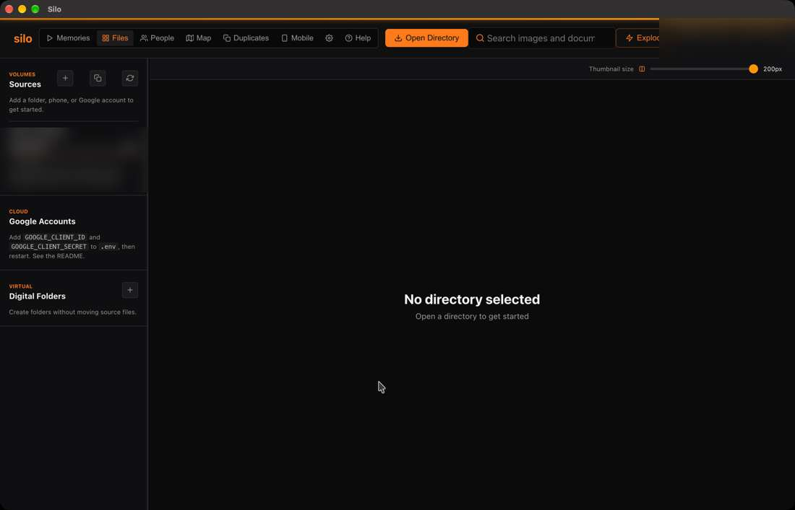

# Silo User Guide

**Your files, one local-first library.** Browse folders, drives, connected phones and selected cloud files; search photos by meaning; organize with people, places and virtual collections; review duplicates; and make memory videos.

> Updated for **Silo 2.1.4**, reviewed on **October 15, 2026** against the official GitHub release tag **v2.1.4**. Screenshots are from an earlier preview and may differ from the current layout. This is a source review, not a new end-to-end test of every installer or checkout. See [Compatibility and known limits](13-compatibility.md).

## Start here

1. [Install and take the first tour](00-getting-started.md)
2. [Add a folder and learn the Files workspace](01-files-and-sources.md)
3. [Understand indexing and semantic search](02-search-and-indexing.md)
4. [Choose the feature you need](#guide)

## Guide

- [People and face scanning](03-people.md)
- [Digital folders and offline references](04-digital-folders.md)
- [Map and photo locations](05-map.md)
- [Duplicates and safe review](06-duplicates.md)
- [Memories and story videos](07-memories.md)
- [Phones, backups and messages](08-mobile.md)
- [Google Drive and Google Photos](09-cloud-sources.md)
- [Shelter copies and Time Machine](10-backups.md)
- [Settings, storage and privacy](11-settings-and-privacy.md)
- [Troubleshooting](12-troubleshooting.md)
- [Compatibility and known limits](13-compatibility.md)
- [License, demo and support access](14-license-and-demo.md)

## What Silo does

Silo presents selected sources in a unified desktop workspace. It keeps original files where they are unless you choose an action that changes them. Search indexes, face groups, location indexes, thumbnails and other derived data are local Silo data; they are not substitutes for a backup of your originals.

Most first-run tasks take time on a large library. Finding files, preparing CLIP search, face scanning, location extraction, duplicate hashing and thumbnail generation are separate jobs. A progress bar reaching 100% for one job does not mean every other job is complete.

## Recent improvements

- **Search and indexing:** startup/storage recovery and Intel native-index loading have been improved; completed-stage counts are reconciled, and a few unreadable files no longer trigger a systemic indexing-failure report.
- **Memories:** automatic suggestions after startup indexing settles and every 24 hours while Silo remains open, a working **Generate Memories** replacement flow with live progress, background movie preparation, a Memory Book of finished movies, and full-screen playback.
- **Mobile and Map:** bundled phone tools, compact device action toolbars, a backup confirmation/destination dialog, and clearer map counts and collapsible sidebar sections.
- **Licensing and updates:** finalized Solana USDC verification through the license relay, signed licenses bound to one computer, corrected wallet links, automatic closing after activation, and in-place macOS updates.

See the individual chapters for requirements and remaining limits; these improvements do not guarantee that every file is readable or every device is supported.

## Official links

- [Try Silo website](https://trysilo.kolektivkrog.si/)
- [Silo source code on GitHub](https://github.com/ilovespectra/Silo)

## Privacy at a glance

- Local folders are processed on the Mac. CLIP search and face detection use local models after the required model files are available.
- Google Drive and Google Photos require online Google access. Google Photos is limited to items you explicitly choose through Google Photos Picker.
- Phone browsing needs the phone connected and trusted. Silo fetches a remote phone file when you open or export it.
- A Silo library share allows people with its link on the same trusted Wi-Fi network to browse, search, preview and download the included media. It uses unencrypted local HTTP.
- Configuration exports can contain sign-in tokens. Keep them private.

## Silo look and feel

This guide uses Silo's black and orange identity. The website follows your device's light or dark appearance by default; use the theme control in the page header to switch modes at any time. The guide remains readable in both themes.
